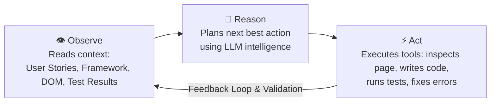
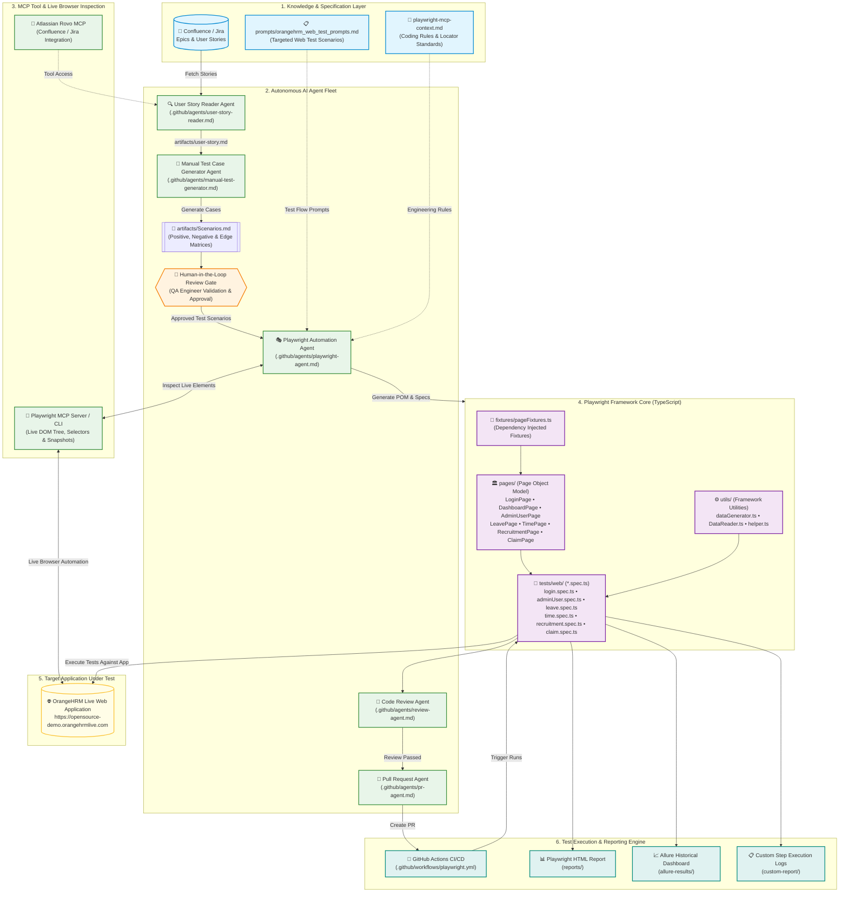
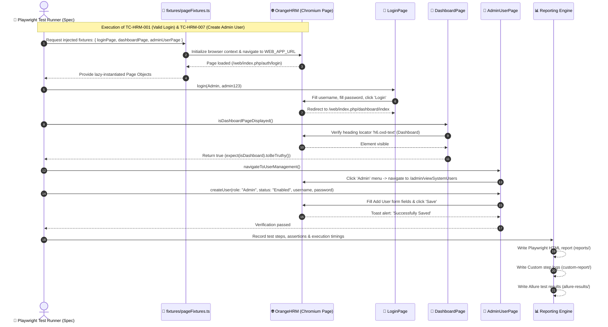
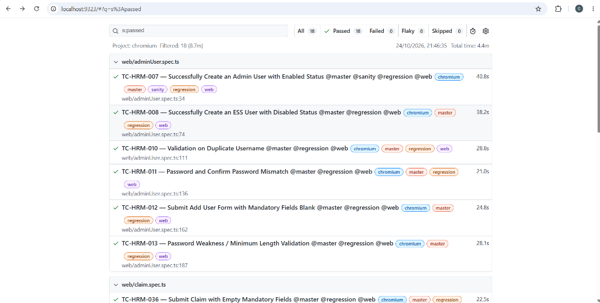

# 🤖 AI-Driven Playwright Automation Framework (OrangeHRM)

[](https://playwright.dev/)
[](https://www.typescriptlang.org/)
[](https://playwright.dev/)
[](https://nodejs.org/)

An enterprise-grade, end-to-end test automation framework built with **Playwright**, **TypeScript**, and an autonomous **STLC Multi-Agent AI Architecture**. This framework targets the **OrangeHRM** HR management platform (`https://opensource-demo.orangehrmlive.com/`), implementing robust Page Object Models (POM), custom dependency-injected fixtures, data-driven execution, and dynamic test reporting.

---

## 📑 Table of Contents

- [Overview & Vision](#-overview--vision)
- [How AI Is Working Here (Multi-Agent STLC)](#-how-ai-is-working-here-multi-agent-stlc)
  - [The Agent Loop (Observe – Reason – Act)](#the-agent-loop-observe--reason--act)
  - [STLC Multi-Agent Pipeline](#stlc-multi-agent-pipeline)
  - [Agent Roles & Responsibilities](#agent-roles--responsibilities)
  - [Model Context Protocol (MCP) & Playwright CLI](#model-context-protocol-mcp--playwright-cli)
  - [Human-in-the-Loop (HITL) Collaboration](#human-in-the-loop-hitl-collaboration)
- [Framework Architecture & Implementation](#-framework-architecture--implementation)
  - [Page Object Model (POM)](#page-object-model-pom)
  - [Custom Fixtures Injection](#custom-fixtures-injection)
- [Multi-Agent & Framework Architecture Diagrams](#-multi-agent--framework-architecture-diagrams)
  - [1. Multi-Agent AI System & STLC Architecture](#1-multi-agent-ai-system--stlc-architecture)
  - [2. OrangeHRM Playwright Test Execution Sequence](#2-orangehrm-playwright-test-execution-sequence)
- [Project Directory Structure](#-project-directory-structure)
- [Prerequisites & Getting Started](#-prerequisites--getting-started)
  - [Prerequisites](#prerequisites)
  - [Installation](#installation)
  - [Environment Configuration](#environment-configuration)
- [Test Execution & Commands](#-test-execution--commands)
  - [Running by Tags](#running-by-tags)
  - [Running in Headed & Debug Modes](#running-in-headed--debug-modes)
- [Reporting & Artifacts](#-reporting--artifacts)
- [CI/CD Automation](#-cicd-automation)

---

## 🌟 Overview & Vision

Modern quality engineering is shifting from manually writing repetitive test scripts to **orchestrating intelligent AI agents**. In this repository:
- **QA Engineers** define requirements, guide architectures, and provide human-in-the-loop oversight.
- **AI Agents** interact with knowledge systems (Confluence/Jira), analyze user stories, draft comprehensive test scenarios, inspect DOM elements using browser automation protocols, generate TypeScript test code adhering to framework conventions, and review pull requests.

---

## 🧠 How AI Is Working Here (Multi-Agent STLC)

### The Agent Loop: Observe – Reason – Act

Unlike simple LLM text-completion tools that hallucinate untested code, this project operates on **autonomous AI agents** executing an iterative feedback loop:



1. **Observe**: The agent reads context from specification documents (`artifacts/user-story.md`, `playwright-mcp-context.md`), runs commands, or inspects live page DOM via browser tools.
2. **Reason**: The agent evaluates acceptance criteria, determines needed test paths (positive, negative, boundary), and designs code matching project design patterns.
3. **Act**: The agent writes clean TypeScript files, generates Page Objects, runs tests via terminal tools, inspects errors, and self-corrects until tests pass reliably.

---

### STLC Multi-Agent Pipeline

The framework automates the entire Software Testing Life Cycle (STLC) across specialized agents defined under `.github/agents/`:

```mermaid
flowchart LR
    CONF[("📘 CONFLUENCE<br/>Requirements / Stories")] --> USA["🔍 USER STORY AGENT<br/>Fetches & Normalizes User Story"]
    USA --> MTCA["🤖 MANUAL TEST CASE AGENT<br/>Drafts Scenarios & Matrices"]
    MTCA --> SCEN[["📄 Scenarios.md"]]
    SCEN --> HIL{{"👤 HUMAN IN THE LOOP<br/>Review, Refine & Approve"}}
    HIL --> PA["🎭 PLAYWRIGHT AGENT<br/>Generates POM, Fixtures & Specs"]
    PA --> RA["🔎 REVIEW AGENT<br/>Code Quality & Flakiness Audit"]
    RA --> MR["🔀 PR AGENT<br/>Raises Merge Request with Context"]
    MR --> SUB(["✅ MERGED TO MAIN"])

    classDef source fill:#e1f5fe,stroke:#0288d1,stroke-width:2px;
    classDef agent fill:#e8f5e9,stroke:#388e3c,stroke-width:2px;
    classDef human fill:#fff3e0,stroke:#f57c00,stroke-width:2px;
    classDef review fill:#f3e5f5,stroke:#7b1fa2,stroke-width:2px;
    classDef pr fill:#ede7f6,stroke:#512da8,stroke-width:2px;
    classDef done fill:#e8f5e9,stroke:#2e7d32,stroke-width:2px;

    class CONF source;
    class USA,MTCA,PA,MR agent;
    class HIL human;
    class RA review;
    class SUB done;
```



---

### Agent Roles & Responsibilities

| Agent | Config File | Responsibilities | Tools & Integration |
| :--- | :--- | :--- | :--- |
| **User Story Reader** | `.github/agents/user-story-reader.md` | Retrieves user stories and acceptance criteria from Confluence or Jira, saving structured requirements to `artifacts/user-story.md`. | Atlassian Rovo MCP, file system |
| **Manual Test Generator** | `.github/agents/manual-test-generator.md` | Analyzes acceptance criteria, breaks them into positive, negative, and edge test scenarios, and generates `artifacts/Scenarios.md` with traceability matrices. | File read/write, markdown generation |
| **Playwright Agent** | `.github/agents/playwright-agent.md` | Reads approved scenarios and constructs Page Objects (`pages/`), test specs (`tests/web/`), fixtures (`fixtures/`), and test data generators. | Playwright MCP, browser subagents, file edit tools |
| **Review Agent** | `.github/agents/review-agent.md` | Conducts automated code review on generated tests, checking locator resilience, assertions, test isolation, and flakiness risks. | Static analysis, linting, rules verification |
| **PR Agent** | `.github/agents/pr-agent.md` | Formulates PR descriptions with test case mapping, execution logs, and tags before merging into the main branch. | GitHub CLI, Git automation |

---

### Model Context Protocol (MCP) & Playwright CLI

AI agents do not guess application behavior. They interact with the live OrangeHRM application using:
- **Playwright MCP (Model Context Protocol)**: Exposes browser capabilities directly to the agent LLM, allowing it to navigate pages, inspect elements, test selectors, capture snapshots, and observe dynamic DOM changes.
- **Context Governance (`playwright-mcp-context.md`)**: A deterministic rulebook that instructs agents on naming conventions, folder structure, strict separation of concerns, and locator priorities (e.g., `getByRole`, `getByPlaceholder`, avoid fragile XPaths).
- **Step-by-Step Prompt Catalog (`prompts/orangehrm_web_test_prompts.md`)**: Provides structured test flows covering Login, User Management, Leave, Time, Recruitment, Claim, and Data-Driven scenarios.

---

### Human-in-the-Loop (HITL) Collaboration

The AI system is strictly **assistive and supervised**:
1. AI generates manual test scenarios (`artifacts/Scenarios.md`).
2. **QA Engineers review and approve** test coverage, adjusting business-critical edge cases.
3. Once approved, the Playwright Agent is triggered to implement automated code.
4. QA Engineers run and validate execution locally before final PR merge.

---

## 🏗️ Framework Architecture & Implementation

### Page Object Model (POM)

Every web page is modeled into an independent TypeScript class under `pages/`, encapsulating page selectors and user interactions:
- [LoginPage.ts](file:///d:/ai-agent/pages/LoginPage.ts) — Authentication actions, error alerts, required field validations.
- [DashboardPage.ts](file:///d:/ai-agent/pages/DashboardPage.ts) — Dashboard heading, URL validation, user profile widget.
- [AdminUserPage.ts](file:///d:/ai-agent/pages/AdminUserPage.ts) — System user search, user role/status assignment, creation forms, password validation.
- [LeavePage.ts](file:///d:/ai-agent/pages/LeavePage.ts) — Leave list filtering by status, employee hint, and date bounds.
- [TimePage.ts](file:///d:/ai-agent/pages/TimePage.ts) — Timesheet view, weekly hours verification, timesheet submit controls.
- [RecruitmentPage.ts](file:///d:/ai-agent/pages/RecruitmentPage.ts) — Vacancy creation, hiring manager selection, active status validation.
- [ClaimPage.ts](file:///d:/ai-agent/pages/ClaimPage.ts) — Expense claim creation and mandatory field checks.

### Custom Fixtures Injection

Tests never instantiate page objects manually with `new LoginPage(page)`. Instead, `fixtures/pageFixtures.ts` leverages Playwright's built-in dependency injection:

```typescript
// tests/web/login.spec.ts
import { test, expect } from '../../fixtures/pageFixtures';

test('TC-HRM-001 — Valid Login @master @sanity @regression @web', async ({ loginPage, dashboardPage }) => {
    await loginPage.login(username, password);
    expect(await dashboardPage.isDashboardPageDisplayed()).toBeTruthy();
});
```

Benefits:
- **Clean test files**: Zero boilerplate setup/teardown code in test specs.
- **Lazy Initialization**: Page Objects are instantiated only when requested by the test signature.
- **Auto-Cleanup**: Playwright manages lifecycle, cookies, and contexts cleanly.

### Utility & Helper Ecosystem

- **`dataGenerator.ts`**: Uses `@faker-js/faker` to generate unique usernames, employee names, random strings, and timestamps to ensure test independence.
- **`DataReader.ts`**: Reads test data from JSON, CSV (`csv-parse`), and Excel (`xlsx`) files for data-driven testing.
- **`helper.ts`**: Centralizes access to environment variables, credentials, timeouts, and date-time operations (`luxon`).
- **`CustomReporter.ts`**: Emits real-time step execution summaries and structured console outputs.

---

## 📊 Multi-Agent & Framework Architecture Diagrams

### 1. Multi-Agent AI System & STLC Architecture

This architectural diagram illustrates how the autonomous multi-agent system operates across the entire Software Testing Life Cycle (STLC) — from fetching requirements in Confluence to code generation, review, browser inspection, and CI/CD test execution:



---

### 2. OrangeHRM Playwright Test Execution Sequence

This sequence diagram details the runtime execution lifecycle in this project, illustrating how test fixtures inject initialized Page Objects, interact with the OrangeHRM web application, and generate multi-tier test reports:



---

## 📁 Project Directory Structure

```text
ai-agent/
├── .github/
│   ├── agents/                   # AI Agent role definitions
│   │   ├── user-story-reader.md  # Reads user stories from Confluence
│   │   ├── manual-test-generator.md # Generates test scenarios
│   │   ├── playwright-agent.md   # Generates Playwright framework code
│   │   ├── review-agent.md       # Reviews code & flakiness
│   │   └── pr-agent.md           # Generates PRs
│   └── workflows/
│       └── playwright.yml        # GitHub Actions CI pipeline
├── artifacts/                    # Intermediate agent deliverables
│   ├── user-story.md             # Normalized user story from Confluence
│   ├── Scenarios.md              # Approved manual test scenarios & matrix
│   └── new-scenarios.md          # Multi-story scenario definitions
├── docs/
│   └── Framework-Step-By-Step.md # Step-by-step framework design guide
├── fixtures/
│   └── pageFixtures.ts           # Playwright custom fixtures injection
├── pages/                        # Page Object Model classes
│   ├── LoginPage.ts
│   ├── DashboardPage.ts
│   ├── AdminUserPage.ts
│   ├── LeavePage.ts
│   ├── TimePage.ts
│   ├── RecruitmentPage.ts
│   └── ClaimPage.ts
├── prompts/                      # Test generation prompt instructions
│   ├── orangehrm_web_test_prompts.md # OrangeHRM web test scenarios
│   └── utilitis_prompt.md        # Guidelines for helper & utility generation
├── tests/
│   └── web/                      # Playwright test specs
│       ├── login.spec.ts         # US-HRM-001 (TC-001 to TC-006)
│       ├── adminUser.spec.ts     # US-HRM-006 (TC-007 to TC-013)
│       ├── leave.spec.ts         # US-HRM-007 (TC-014, TC-018, TC-019)
│       ├── time.spec.ts          # US-HRM-008 (TC-021)
│       ├── recruitment.spec.ts   # US-HRM-009 (TC-027, TC-029)
│       └── claim.spec.ts         # US-HRM-010 (TC-036)
├── testdata/                     # External data for DDT (CSV / JSON / XLSX)
├── utils/                        # Shared framework utilities
│   ├── CustomReporter.ts
│   ├── DataReader.ts
│   ├── dataGenerator.ts
│   └── helper.ts
├── .env                          # Local environment variables (URL, credentials)
├── .env.example                  # Template environment configuration
├── playwright.config.ts          # Playwright test runner configuration
├── playwright-mcp-context.md     # Master context instructions for AI agents
├── package.json                  # Scripts and dependencies
└── tsconfig.json                 # TypeScript strict compiler options
```

---

## 🚀 Prerequisites & Getting Started

### Prerequisites

- **Node.js**: `v18.x` or later installed ([Download](https://nodejs.org/))
- **npm**: `v9.x` or later
- **VS Code**: Recommended IDE

### Installation

1. **Clone the repository:**
   ```bash
   git clone <repository-url>
   cd ai-agent
   ```

2. **Install project dependencies:**
   ```bash
   npm install
   ```

3. **Install Playwright browser binaries:**
   ```bash
   npx playwright install --with-deps
   ```

### Environment Configuration

Configure your `.env` file in the project root (copied from `.env.example`):

```ini
# ENVIRONMENT
APP_ENV=qa

### WEB APP CONFIGURATION ###
WEB_APP_URL=https://opensource-demo.orangehrmlive.com/web/index.php/auth/login

# WEB APP CREDENTIALS
ADMIN_USERNAME=Admin
ADMIN_PASSWORD=admin123
```

---

## ⚡ Test Execution & Commands

### Running by Tags

Tests are categorized using Playwright tags (`@master`, `@sanity`, `@regression`, `@web`, `@e2e`, `@datadriven`):

```bash
# Run all tests marked for master release
npm run test:master

# Run sanity smoke test suite
npm run test:sanity

# Run full regression test suite
npm run test:regression

# Run only web UI tests
npm run test:web

# Run end-to-end user journeys
npm run test:e2e

# Run data-driven login tests
npm run test:datadriven
```

### Running in Headed & Debug Modes

```bash
# Run tests with visible browser window
npm run test:master:headed

# Run sanity tests in Playwright interactive inspector debugger
npm run test:sanity:debug

# Run a specific test spec directly
npx playwright test tests/web/login.spec.ts --headed
```

---

## 📊 Reporting & Artifacts

The framework produces multi-tier reporting for local debugging and CI pipelines:

1. **Playwright HTML Report:**
   Output folder: `reports/` (configured in `playwright.config.ts`)
   ```bash
   # Open the generated HTML report
   npx playwright show-report reports
   ```
   Contains interactive step timings, failed step screenshots, execution traces, and video recordings.

   #### 📸 Test Execution Results (18/18 Passed):
   

2. **Console Step Reporter:**
   Uses `utils/CustomReporter.ts` to log real-time test steps with status indicators (`✅ PASSED`, `❌ FAILED`) and automatically writes timestamped execution logs to `custom-report/report-*.txt`.

3. **Allure Report Integration:**
   Raw test results are captured under `allure-results/`.
   ```bash
   # Generate and serve the Allure HTML report locally
   npx allure serve allure-results

   # Alternatively, generate a static report:
   npx allure generate allure-results --clean -o allure-report
   npx allure open allure-report
   ```

---

## 🔄 CI/CD Automation

Continuous Integration and manual execution are configured via GitHub Actions in [.github/workflows/playwright.yml](file:///d:/ai-agent/.github/workflows/playwright.yml):

- **Automated Triggers:**
  - Push and Pull Requests targeting the `main` branch.
  - **Scheduled Cron Job**: Runs automatically every day at **10:00 AM IST** (`30 4 * * *` UTC).
- **Manual Execution (`workflow_dispatch`):**
  - Trigger manually via **GitHub → Actions → 🎭 Playwright Tests → Run workflow**.
  - **Customizable Inputs:**
    - `test_suite`: Choose between `test:master`, `test:sanity`, `test:regression`, `test:web`, `test:datadriven`, `test:e2e`.
    - `browser`: Select `chromium`, `firefox`, or `webkit`.
    - `mode`: Toggle between `headless` and `headed`.
- **Runner Environment:** Windows (`windows-latest`) with Node.js LTS.
- **Automated Artifact Uploads (30-day retention):**
  - `playwright-report` (`reports/`)
  - `custom-report` (`custom-report/`)
  - `allure-results` (`allure-results/`)

