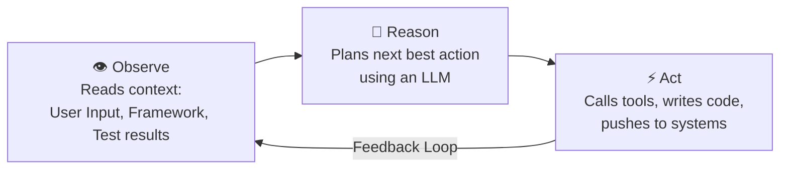

# What Is an AI Agent?

An AI agent is a system built around LLM that combines instructions, tools, and control logic to achieve a goal by reasoning, taking actions, and observing results autonomously and iteratively.

---

## The Agent Loop: Observe – Reason – Act

| Step | Action | Description |
| :--- | :--- | :--- |
| **Observe** | Reads context | User Input, Framework, Test results |
| **Reason** | Plans next action | Plans the next best action using an LLM |
| **Act** | Executes | Calls **tools**, writes **code**, pushes to systems |

---

## LLM vs AI Agent

| Aspect | LLM (Language Model) | AI Agent |
| :--- | :--- | :--- |
| **User Prompt** | *"Generate five login test cases."* | *"Test the login page."* |
| **Capability / Behavior** | Output: Five test cases in text format. | Plans tests, uses browser tools, executes actions, inspects outcomes, and reports results. |

---

## STLC Automation Architecture

> *"QA engineers are no longer just writing tests — they are **orchestrating intelligent agents** that write, review, and ship quality at scale."*

### Workflow Diagram

```mermaid
flowchart LR
    CONF[("📘 CONFLUENCE<br/>User Stories")] --> USA["🔍 USER STORY AGENT<br/>Reads User Story from Confluence"]
    USA --> MTCA["🤖 MANUAL TEST CASE AGENT<br/>Reads User Story & Creates Scenarios.md"]
    MTCA --> SCEN[["📄 Scenarios.md"]]
    SCEN --> HIL{{"👤 HUMAN IN LOOP<br/>Review Scenarios & Provide Input for Automation"}}
    HIL --> PA["🎭 PLAYWRIGHT AGENT<br/>Writes Automation based on Human Input<br/>(Playwright Framework)"]
    PA --> RA["🔎 REVIEW AGENT<br/>Review Test Cases Written by Playwright Agent"]
    RA --> MR["🔀 MERGE REQUEST<br/>Raise PR (Pull Request) for Scenarios and Test Code"]
    MR --> SUB(["✅ SUBMITTED"])

    classDef source fill:#e1f5fe,stroke:#0288d1,stroke-width:2px;
    classDef agent fill:#e8f5e9,stroke:#388e3c,stroke-width:2px;
    classDef human fill:#fff3e0,stroke:#f57c00,stroke-width:2px;
    classDef review fill:#f3e5f5,stroke:#7b1fa2,stroke-width:2px;
    classDef pr fill:#ede7f6,stroke:#512da8,stroke-width:2px;
    classDef done fill:#e8f5e9,stroke:#2e7d32,stroke-width:2px;

    class CONF source;
    class USA,MTCA,PA agent;
    class HIL human;
    class RA review;
    class MR pr;
    class SUB done;
```

---

### Pipeline Components & Responsibilities

| Stage | Component | Type | Responsibility |
| :--- | :--- | :--- | :--- |
| **1** | **Confluence** | Knowledge Source | Contains business requirements, epics, and user stories. |
| **2** | **User Story Agent** | AI Agent | Connects via MCP (Atlassian) to fetch and parse user stories from Confluence. |
| **3** | **Manual Test Case Agent** | AI Agent | Analyzes the parsed user stories and generates comprehensive manual test scenarios into `Scenarios.md`. |
| **4** | **Human in the Loop (HITL)** | QA Engineer Review | Reviews and refines `Scenarios.md`, approves test paths, and supplies automation inputs/parameters. |
| **5** | **Playwright Agent** | AI Agent | Implements end-to-end automation test scripts in Playwright based on the approved scenarios and human input. |
| **6** | **Review Agent** | AI Agent | Reviews generated test scripts for standards, assertions, linting, robustness, and flakiness. |
| **7** | **Merge Request (PR)** | CI/CD / Git | Creates a pull request containing both `Scenarios.md` and Playwright test code for merge approval. |
| **8** | **Submitted** | Milestone | Pipeline completed, test suite merged into the repository test suite. |

---

## 📚 Step-by-Step Implementation

1. Create the `.github` folder in your project.
2. Create the `agents` folder inside `.github`.
3. Create an agent definition Markdown file (`.md`).
4. Configure the agent with instructions, tools, and the appropriate model.
5. Select the custom agent from Chat Mode.
6. Start using your agent to read and save user stories.
